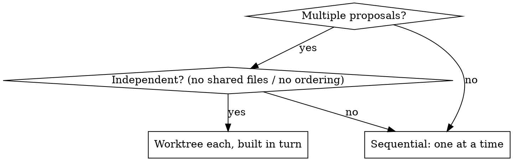

# Parallel Development

## Overview

When a session involves more than one proposal, each gets its own git worktree, so their changes never mix, and the main session builds them one after the other, then folds them back in. No sub-agent builds: only the research topics and `/dev:3-review` start agents (Thomas, 2026-11-09: "the explorer, the designer, the implementor, all run in main session, no more subagent. only review is using subagent since it needs clean context", then "the reasearch (explore) agent can sill be subagent driven, since it speeds up the findings / but design, implement MUST stay in main session").

**Core principle:** the main session authors, builds each worktree in turn, commits on each worktree's branch, and only then merges and cleans up.

## When to Use

- Two or more proposals/changes will be created in one session
- Several independent changes could be implemented concurrently

**When NOT to use (go sequential):**

- Changes touch the same files or depend on each other's output
- Only one proposal exists
- Work cannot be cleanly isolated

## Parallelizable? Decide first

## Workflow

### Phase 1 — Author ALL proposals in the main session

The main session creates every proposal and its complete artifacts (proposal, design, specs, tasks) itself. Use `opsx:propose` per change.

### Phase 2 — One worktree per proposal

**REQUIRED SUB-SKILL:** Use superpowers:using-git-worktrees.

Create one worktree per proposal under `./.worktree/<change-id>` (or `./.claude/.worktree/<change-id>`), each on its own branch off the current working branch.

### Phase 3 — Build each worktree in turn

The main session builds one worktree, then the next. In each one it:

- Works only inside that worktree.
- Implements its proposal following `dev:development-guideline` (backend TDD, frontend VDD, visual confirmation).
- Commits all its changes on that worktree's branch.
- Does NOT merge yet.

### Phase 4 — Main session integrates and cleans up

After every worktree is built, the main session:

1. Merges each worktree branch back into the current working branch.
2. Resolves any conflicts (the main session has the full context).
3. Archives each merged change with `opsx:archive` (or `openspec-archive-change`), one at a time.
4. Removes each worktree and its branch after a successful merge (`git worktree remove`).

Never merge or archive inside a worktree — archiving touches the shared spec baseline. Merge, archive, and cleanup happen one change at a time, only after the merge succeeds.

## Quick Reference

| Step | Owner | Action |
|---|---|---|
| Author proposals | Main | Create all artifacts |
| Create worktrees | Main | One per proposal |
| Implement | Main | One worktree at a time |
| Commit | Main | On worktree branch |
| Merge | Main | Into working branch |
| Archive | Main | `opsx:archive` each change |
| Cleanup | Main | Remove worktrees |

## Cross-References

- Methodology each build follows → `dev:development-guideline`
- Worktree mechanics → superpowers:using-git-worktrees
- Proposals → `opsx:propose`; implementing tasks → `opsx:apply`; archiving → `opsx:archive`
